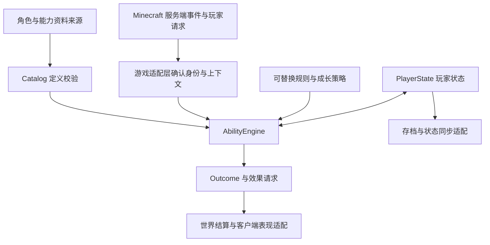

# 实现框架与预期设计

2026-10-21 补充：[开发基础学习记录](learning/README.md) 已整理官方资料和源码案例；[项目影响复查](learning/06-project-implications.md) 进一步说明本原型尚缺的生命周期、会话和游戏适配工作。

2026-10-21 最新边界：[项目拆分与版本要求](design/project-boundaries.md) 记录角色与能力、世界内容两部分分开推进，以及 Minecraft Java 版最低1.20的要求。下述核心框架仍是前期原型，尚未完成这两部分的游戏模块实现。

## 工作边界

目标是建立能够承接后续讨论的实现基础。开局选角、对应外观、技能树、能力网络、成长和动漫专属技能是已提出的需求方向；具体形式仍然开放。

版本范围已收敛为 Minecraft Java 版1.20及以上，具体小版本与加载器尚未固定。已确认多角色培养、当前一主一副、换搭配保留进度，并以科技树和变身器作为角色获取的重要方向。角色名单、切换条件、完整成长模型、科技节点、技能数量、输入方式和皮肤表现仍然开放，详见 [角色讨论稿](design/character-design.md)。这些设计尚未接入当前原型。“能力网络”的含义也未最终确定：技能依赖图、多技能联动、多人共享网络应分别建模，不能直接视作同一个系统。

角色部分先在原版世界中验证角色、能力与成长；新增实体、方块及世界内容后续独立推进。技能所需的临时弹射物、粒子与有限世界操作仍归技能实现，不机械地按游戏 API 类型划分。两部分的基础进度不互锁；合装时通过可选适配增加交互。发行成两个 Mod 或同工程的可选模块仍待验证后选择。

## 结构

核心不导入 `net.minecraft`、Forge、NeoForge 或 Fabric 类。这样可先验证状态逻辑，后续由具体平台适配生命周期、输入、网络、实体、存档与渲染。

## 已实现的逻辑

### 资料与能力依赖

`AbilityDefinition` 包含稳定 ID、阶数上限、硬前置、学习成本、释放成本和冷却。`ProfileDefinition` 是可选的内容分组，可以引用能力与外观资料。

`Catalog` 在加载时拒绝重复 ID、无效引用、无法达到的前置阶数和循环依赖。这里的循环检查只针对解锁前置；将来设计技能联动或多人网络时，不能把这一限制照搬到它们的关系图上。

所有资料尚由代码构建。未来文件加载器应先生成候选 Catalog，完整校验后再替换正在使用的版本。

### 玩家实例状态

`PlayerState` 保存选择槽、已学能力阶数、通用资源余额和冷却截止时间。选择槽没有固定为某个角色；策略可以决定哪些槽可用、能否选择或更换资料。

选择资料不会隐式赠送技能或清空成长。赠送、继承、重置和禁止切换应由明确的玩法操作实现。

快照包含稳定内容 ID，不依赖注册顺序。正式存档适配器应存储 schema 版本并实现迁移；被暂时移除的内容 ID 目前可保留在快照里，但引擎不能释放 Catalog 中不存在的能力。

### 学习与释放

学习依次检查：能力存在、阶数上限、前置关系、外部规则、资源余额；通过后提交学习成本与阶数变化。

释放依次检查：能力存在、已经学会、冷却到期、外部规则、资源余额、行为存在；随后由行为准备效果请求，准备成功后再提交资源和冷却。拒绝、准备阶段异常和数值溢出不会提前扣费。

当前释放流程适用于一次提交的动作。它尚不包含蓄力、持续施法、中断和引导会话。后续加入这些类型时，应实现独立会话：请求 → 准备 → 激活 → 持续 → 完成或取消，并由策略规定在哪个阶段扣费、计冷却或退款。

### 成长与资源

`ProgressionPolicy` 从服务端确认的事件生成奖励，可以接收战斗、训练、探索或其他事件。核心不判断经验曲线，也不自动把奖励换算成等级。

当前资源模型支持通用余额、扣费与奖励。实际过载上升、资源上限、持续消耗、动态学习成本和多阶段付费仍需增加资源变更计划，统一校验后提交；不能在技能准备函数里偷偷修改玩家状态。

## 需要接入的平台部分

| 适配部分 | 预期职责 | 当前状态 |
| --- | --- | --- |
| 玩家生命周期 | 加入、首次选择、重生、退出和状态恢复 | 接入时设计触发规则 |
| 请求处理 | 绑定真实发送者、主线程调度、限频、权限和目标校验 | 契约已说明，网络实现待接入 |
| 世界效果 | 射线、弹射物、伤害、位移、方块交互及环境规则 | 目前输出 EffectIntent |
| 状态同步 | 向本人同步私有进度；向观察者同步公开外观和效果 | Presentation 接口 |
| 存档 | 读写玩家数据、版本迁移、保存失败处理 | PlayerRepository 接口 |
| 外观 | 可选皮肤覆盖、模型、服装或保留原外观 | 仅有资料引用和同步接口 |
| 界面 | 角色、能力图、资源和快捷操作界面 | 尚未绑定界面布局 |
| 时间 | 提供跨重载一致的服务端 tick 时间线 | Clock 接口 |

外观切换应通过游戏渲染层实现，不需要先改动账号皮肤。最终采用纹理覆盖、额外服装还是完整模型，需要在平台与表现目标确定后验证第一人称、盔甲和多人可见性。

技能行为必须使用服务端确认的目标与位置。`EffectIntent` 的通用参数仅是原型载体，接入具体技能时应定义有类型、可校验的效果对象。

状态提交与世界结算不是一个事务。目前引擎返回效果请求，适配器尚未实现幂等消费、失败补偿和异常恢复。正式联机流程需要明确请求 ID、效果 ID 和失败策略，不能把客户端发来的效果参数直接执行。

## 建议的后续顺序

以下是设计确认后的工程建议。当前工作仍为设计问答，用户明确确认方案后才进入主题玩法实现。

1. 继续梳理旧模组的能力上下文、输入生命周期与网络边界，逐步核对 1.1.3 对应源码。
2. 在需求讨论后确定目标游戏版本与加载器，建立最小可启动模组和专用服务器入口。
3. 接入玩家数据、资料加载、请求校验和存档，以合成技能贯通一次学习与释放。
4. 用真实游戏环境验证效果、冷却、断线重连、死亡重生和多人观察。
5. 再把讨论确定的动漫角色、成长规则、能力网络和视觉表现填入框架。

这里的顺序是工程推进建议，不是已确认的玩法规格。

## 本次验证及限制

前期原型使用 JDK 17 编译为 Java 8 兼容字节码，零第三方依赖；2026-10-21 本轮已用项目内 JDK 21 重新运行原有场景并通过。场景验证覆盖：策略拒绝、依赖解锁、学习扣费、释放准备失败、效果生成、冷却边界、快照恢复、只读快照、奖励和时间溢出、无效定义。

本次未验证 Minecraft 启动、磁盘存档、网络协议、真实世界结算、角色渲染或客户端界面。持续施法与多人共享能力网络目前只有扩展方向，没有实现完成的声明。
